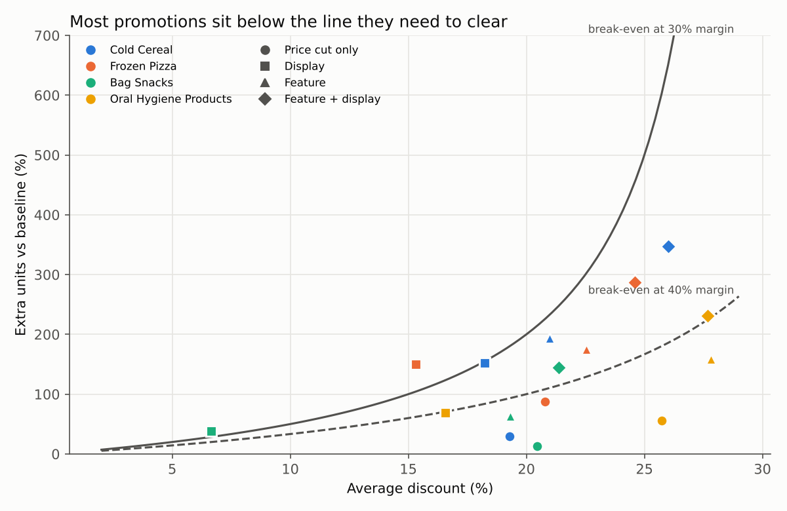
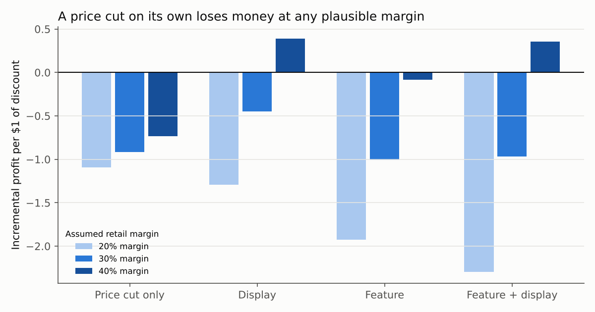
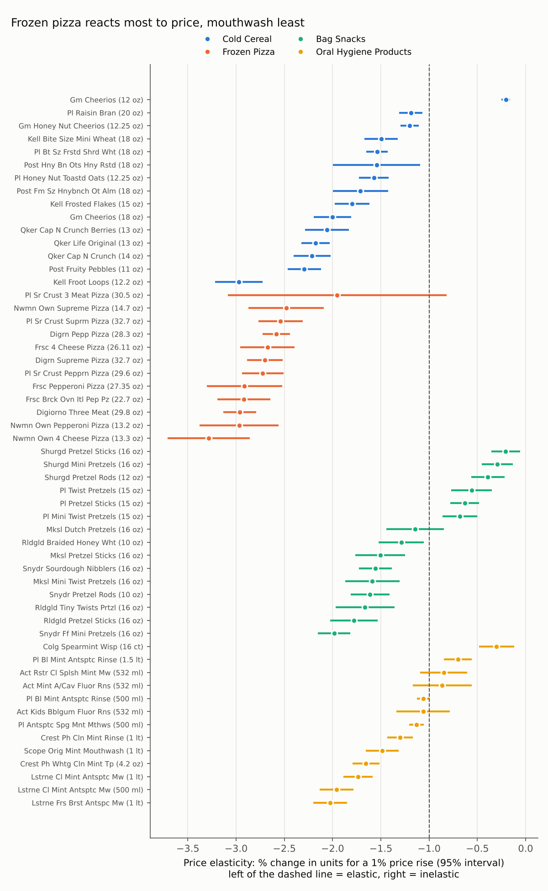
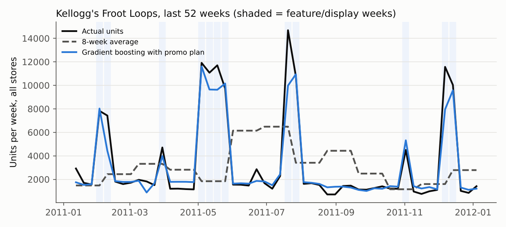

# FMCG pricing, promotion and forecast pack

**▶ Try it live:** [loay-elsafty.netlify.app/fmcg-pricing](https://loay-elsafty.netlify.app/fmcg-pricing/): move a price, test a promotion against its break-even, compare the forecast with what sold.

Three questions a category manager or revenue growth team asks every quarter, answered on three years of real supermarket scanner data in Python:

1. **How much do sales move when price moves?** Price elasticity for 55 products.
2. **Which promotions actually earn their discount?** Every promotion week compared with what would have sold anyway.
3. **How well can we forecast weekly demand, and what makes the forecast good?** A backtested forecast against honest baselines.

**Data:** dunnhumby's *Breakfast at the Frat*: 156 weeks (Jan 2009 – Jan 2012), 77 US stores, 55 products in cold cereal, frozen pizza, pretzels and mouthwash, with shelf price, regular price and three promotion flags (in the weekly ad, on display, price cut only). 524,741 store-product-weeks, 10.3M units, $27.9M sales.

## What I found, and what I'd do about it

### 1. Price cuts on their own don't pay. Stop most of them.

**47% of all promotion weeks** were a price cut with no ad and no display. They lifted volume by just **+30% on a 22% discount**: **77% of the units sold on deal would have sold anyway**, at full price. At a 30% retail margin they made money in **7% of weeks**, and they lose money at 20% and 40% margins too.

A price cut only pays if volume clears a break-even line: at a 30% margin, a 20% discount needs **+200%** more units just to stand still. Feature + display gets close (**+315% on a 25% discount**); a quiet price cut never does.



**Decision:** cut most price-cut-only weeks and put the money behind fewer, supported events (ad + display), where shoppers actually notice the deal. Check every promotion against its break-even lift before it's approved.



### 2. Price sensitivity differs 2.5x between categories

| Category | Median elasticity | +5% price → units | +5% price → gross profit (30% margin) |
|---|---|---|---|
| Frozen pizza | -2.71 | -12.4% | +2.2% |
| Cold cereal | -1.71 | -8.0% | +7.3% |
| Bag snacks (pretzels) | -1.29 | -6.1% | +9.6% |
| Mouthwash / oral care | -1.13 | -5.4% | +10.4% |

**Decision:** if prices have to rise, take it in oral care and pretzels first, where volume barely moves, and protect frozen pizza, where shoppers switch. Every product is in the chart below with its confidence interval. Several private-label and value pretzels are below 1 (inelastic) and are the clearest candidates.



### 3. The promotion plan is what makes a forecast good, not the algorithm

Rolling backtest over the last year: 13 forecast dates, 4 weeks ahead each, 52 products, 2,620 product-weeks scored.

| Model | Error (WAPE) | Bias |
|---|---|---|
| Last week's sales | 41.5% | -0.6% |
| Same week last year | 49.1% | +7.0% |
| 8-week average | 38.5% | +0.6% |
| Gradient boosting, **without** the promo plan | 35.3% | -5.0% |
| **Gradient boosting, with the planned price and promotions** | **19.0%** | +1.3% |

The machine-learning model alone barely beats an 8-week average. Give it the promotion calendar and planned prices, which a supplier knows weeks ahead, and the error halves, from 38.5% to 19.0%. It's best in cereal (45% → 20%) and pizza (53% → 23%), the categories that promote hardest.



**Decision:** connect the demand forecast to the trade-promotion plan. A forecast that doesn't know about next month's display will be wrong exactly when it matters, in the promotion weeks.

## How it works

| Step | Method | File |
|---|---|---|
| Clean | Drop rows with no price or no sales, cap shelf price at regular price, label the promotion mechanic, de-duplicate two stores listed twice | [`fmcg/data.py`](fmcg/data.py) |
| Elasticity | One regression per product: log(units) on log(price), ad, display and the week after a promotion, with store, month and year effects; errors clustered by store | [`fmcg/elasticity.py`](fmcg/elasticity.py) |
| Promotions | The model's prediction at regular price with no ad/display = the baseline. Incremental units, discount given away on baseline units, incremental profit at an assumed margin | [`fmcg/promo.py`](fmcg/promo.py) |
| Scenarios | Units, revenue and profit for ±5% / ±10% price moves by category | [`fmcg/simulate.py`](fmcg/simulate.py) |
| Forecast | Weekly units per product; rolling-origin backtest against three simple baselines; gradient boosting with and without the promotion plan | [`fmcg/forecast.py`](fmcg/forecast.py) |

Full numbers: [`reports/results.md`](reports/results.md) · every product's elasticity: [`reports/elasticity_by_product.csv`](reports/elasticity_by_product.csv)

**Tests** ([`tests/`](tests/)): on synthetic data with known answers, the model recovers a true elasticity of -2.0 and a known ad lift, the baseline strips the promotion effect, profit is exactly zero at break-even, and the error metrics compute correctly.

## What this can't tell you (read before using the numbers)

- **No cost data.** Profit uses an assumed retail margin, shown at 20%, 30% and 40%. The price-cut conclusion holds at all three; the feature + display one doesn't (it pays at 40%, not at 30%).
- **Retailer's view only.** Supplier funding of promotions isn't in the data. A promotion that loses the retailer money can still pay if the supplier funds the discount, and vice versa for the supplier.
- **Elasticities from shop data run high.** Prices aren't set at random: retailers cut them when they expect demand. Research comparing real price experiments with shop data (Bray, Sanders & Stamatopoulos, 2024) finds observational elasticities overstate sensitivity, so read these as a *ranking* of which products respond most, not exact numbers.
- **No basket or traffic effects.** A promotion that brings shoppers in and sells them other things looks worse here than it is.
- **Weekly store data, 2009–2011, US.** The method transfers; the numbers are for this retailer and period.

## Run it

```bash
pip install -r requirements.txt
# download "Breakfast at the Frat" free from https://www.dunnhumby.com/source-files/
# and put "dunnhumby - Breakfast at the Frat.xlsx" in data/raw/ (mkdir -p data/raw)
python run_all.py        # ~1 minute: rebuilds every number and chart in reports/
python -m pytest -q      # 9 tests, no data download needed
```

The dataset belongs to dunnhumby and is not redistributed here.

---
Loay Elsafty · [loay-elsafty.netlify.app](https://loay-elsafty.netlify.app) · [linkedin.com/in/loay-elsafty](https://www.linkedin.com/in/loay-elsafty)
