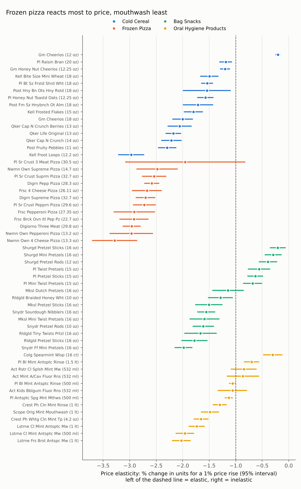
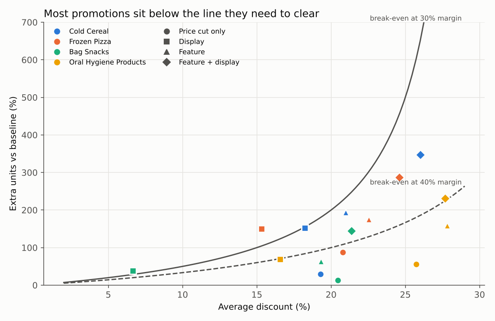
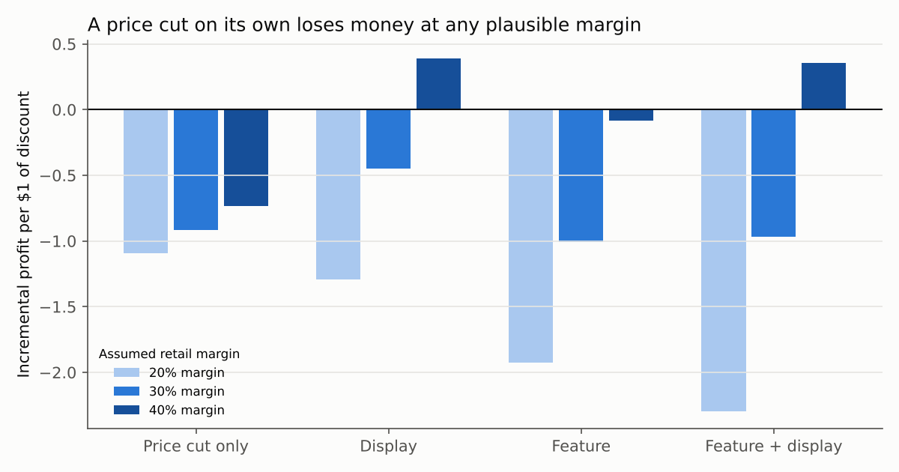
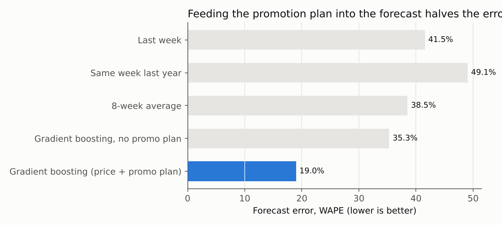
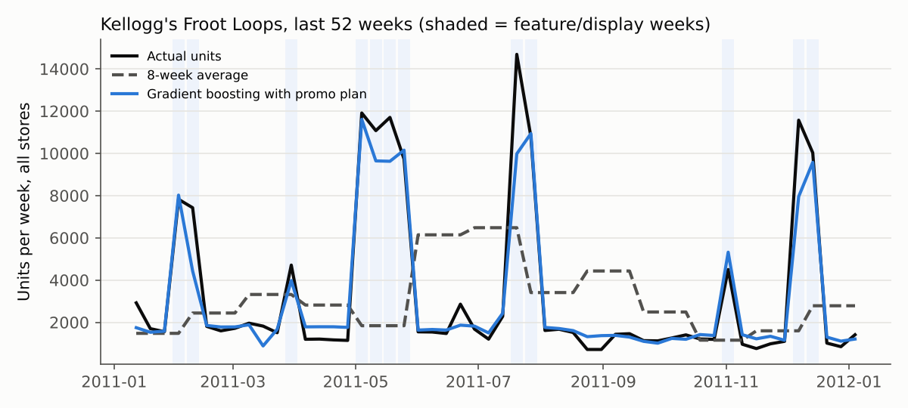

# Results

Data: dunnhumby Breakfast at the Frat · Jan 2009 – Jan 2012 · 77 stores · 55 products · 524,741 store-product-weeks · 10,290,898 units · $27,919,774 sales.

## 1. Price elasticity

All 55 products have a negative elasticity whose 95% interval excludes zero. Median by category:

| Category | Median elasticity |
|---|---|
| Cold Cereal | -1.71 |
| Frozen Pizza | -2.71 |
| Bag Snacks | -1.29 |
| Oral Hygiene Products | -1.13 |

## 2. Promotion economics (assumed 30% retail margin; 20% and 40% shown for sensitivity)

| Mechanic | Promo weeks | Avg discount | Extra units | Share of promo units that are extra | Profit per $1 of discount (20% / 30% / 40%) | Weeks profitable at 30% |
|---|---|---|---|---|---|---|
| Price cut only | 70,733 | 22% | +30% | 23% | -1.10 / -0.91 / -0.73 | 7% |
| Display | 34,291 | 12% | +69% | 41% | -1.29 / -0.45 / 0.39 | 43% |
| Feature | 20,800 | 23% | +174% | 63% | -1.93 / -1.01 / -0.09 | 20% |
| Feature + display | 23,376 | 25% | +315% | 76% | -2.29 / -0.97 / 0.36 | 28% |

## 3. Price scenarios (30% margin, elasticity held constant)

| Category              |   Elasticity | Price change   | Units   | Revenue   | Gross profit   |
|:----------------------|-------------:|:---------------|:--------|:----------|:---------------|
| Bag Snacks            |        -1.29 | -10%           | +14.5%  | +3.1%     | -23.6%         |
| Bag Snacks            |        -1.29 | -5%            | +6.8%   | +1.5%     | -11.0%         |
| Bag Snacks            |        -1.29 | +5%            | -6.1%   | -1.4%     | +9.6%          |
| Bag Snacks            |        -1.29 | +10%           | -11.6%  | -2.7%     | +17.9%         |
| Cold Cereal           |        -1.71 | -10%           | +19.8%  | +7.8%     | -20.2%         |
| Cold Cereal           |        -1.71 | -5%            | +9.2%   | +3.7%     | -9.0%          |
| Cold Cereal           |        -1.71 | +5%            | -8.0%   | -3.4%     | +7.3%          |
| Cold Cereal           |        -1.71 | +10%           | -15.1%  | -6.6%     | +13.3%         |
| Frozen Pizza          |        -2.71 | -10%           | +33.1%  | +19.8%    | -11.3%         |
| Frozen Pizza          |        -2.71 | -5%            | +14.9%  | +9.2%     | -4.2%          |
| Frozen Pizza          |        -2.71 | +5%            | -12.4%  | -8.0%     | +2.2%          |
| Frozen Pizza          |        -2.71 | +10%           | -22.8%  | -15.1%    | +3.0%          |
| Oral Hygiene Products |        -1.13 | -10%           | +12.6%  | +1.4%     | -24.9%         |
| Oral Hygiene Products |        -1.13 | -5%            | +6.0%   | +0.7%     | -11.7%         |
| Oral Hygiene Products |        -1.13 | +5%            | -5.4%   | -0.6%     | +10.4%         |
| Oral Hygiene Products |        -1.13 | +10%           | -10.2%  | -1.2%     | +19.7%         |

## 4. Forecast backtest

13 forecast origins over the last year, 4 weeks ahead each, 52 products, 2,620 product-weeks scored.

| Model | WAPE | Bias |
|---|---|---|
| Last week | 41.5% | -0.6% |
| Same week last year | 49.1% | +7.0% |
| 8-week average | 38.5% | +0.6% |
| Gradient boosting, no promo plan | 35.3% | -5.0% |
| Gradient boosting (price + promo plan) | 19.0% | +1.3% |

| Category | Last week | Same week last year | 8-week average | Gradient boosting, no promo plan | Gradient boosting (price + promo plan) |
|---|---|---|---|---|---|
| Cold Cereal | 49.1% | 58.8% | 45.2% | 40.1% | 20.3% |
| Frozen Pizza | 57.6% | 57.9% | 53.4% | 47.0% | 22.8% |
| Bag Snacks | 17.7% | 25.1% | 17.2% | 19.6% | 14.0% |
| Oral Hygiene Products | 37.1% | 39.2% | 34.3% | 32.2% | 19.5% |

## Headline numbers (used in the README)

- Price-cut-only promotions: 47% of promo weeks, +30% units on a 22% discount; 77% of the units sold on deal would have sold anyway; profitable in 7% of weeks at 30% margin.
- Feature + display: +315% units on a 25% discount.
- Forecast: WAPE 19.0% vs 38.5% for the best simple baseline (51% less error); without the promo plan the same model scores 35.3%.
